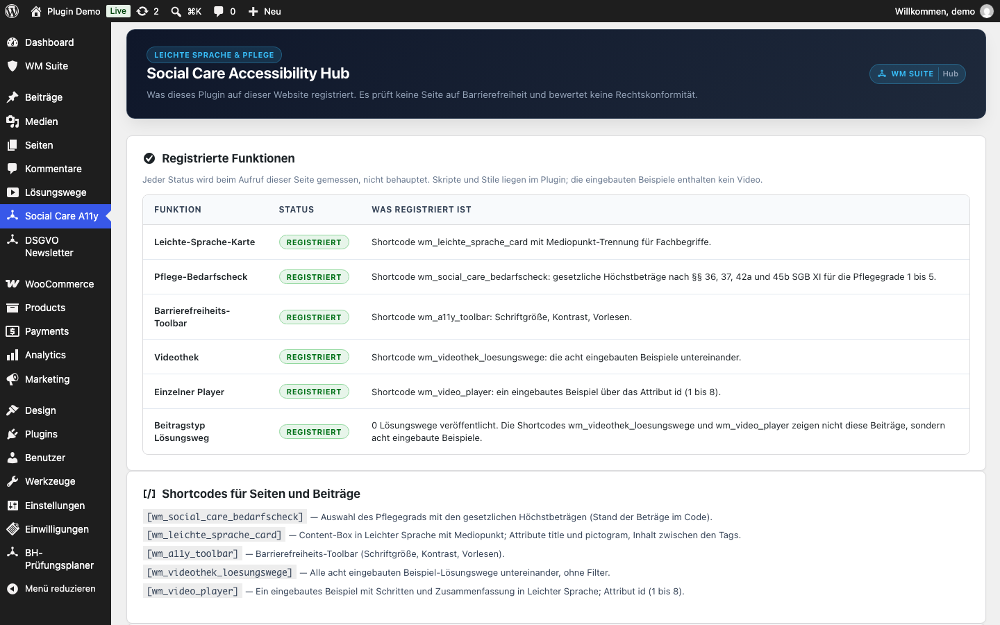
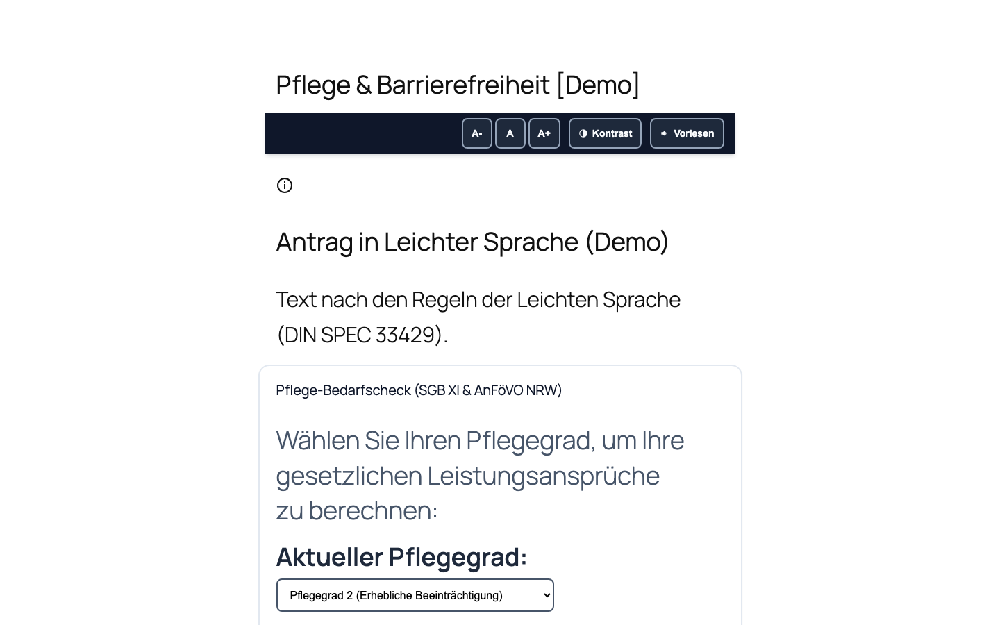

# WM Social Care Accessibility Hub (Deutsche Dokumentation)

<p align="center">
  <a href="README.md"></a>
  <a href="README.de.md"></a>
  <a href="README.es.md"></a>
</p>

> **Fünf Shortcodes für Websites aus Pflege und Betreuung — ein Bedarfscheck mit den gesetzlichen Beträgen nach SGB XI, eine Karte in Leichter Sprache, eine Barrierefreiheits-Toolbar und eine Videothek mit acht eingebauten Beispiel-Anleitungen — sowie Beitragstyp „Lösungsweg“, Block Bindings und GenerateBlocks-Dynamic-Tags; das Plugin prüft keine Website auf Barrierefreiheit und macht sie nicht barrierefrei**  
> **Plugin-Seite:** [https://arnoldwender.com/wordpress-plugins/wm-social-care-accessibility-hub/](https://arnoldwender.com/wordpress-plugins/wm-social-care-accessibility-hub/)  
> **Mit einem agentischen Workflow entwickelt:** entstanden mit KI-Coding-Agenten. Prüfen und testen Sie es wie jeden fremden Code, bevor Sie es produktiv einsetzen.  
> **Support & Haftung:** Kein Support (Zero Support) — reproduzierbare Bugs ausschließlich über [GitHub Issues](https://github.com/arnoldwender/wm-wp-social-care-accessibility-hub/issues) · kein privater Support · OHNE GEWÄHR („AS IS“) / keine Haftung ([SUPPORT.md](SUPPORT.md))

> Diese Datei beschreibt, was das Plugin in Version 1.3.2 ausliefert, gemessen am Code: fünf Shortcodes (`[wm_social_care_bedarfscheck]`, `[wm_leichte_sprache_card]`, `[wm_a11y_toolbar]`, `[wm_videothek_loesungswege]`, `[wm_video_player]`), den Beitragstyp `wm_loesungsweg` mit vier Taxonomien, zwei lesende REST-`GET`-Routen unter `wm-social-care/v1` mit Transient-basiertem HMAC-SHA256-IP-Rate-Limiting, WP-CLI `wp wm-social-care calc` und `seed`, eine Admin-Übersichtsseite mit Opt-in-Schalter für die Deinstallation, Entwickler-Hooks (`wm_social_care_bedarfscheck_result`, `wm_social_care_loesungswege_items`, `wm_social_care_rate_limit_per_minute`, `wm_social_care_ready`), eine WordPress-6.5+-Block-Bindings-Quelle (`wm-social-care/info`), ein GenerateBlocks-2.x-Dynamic-Tag (`{{wm_social_care_info}}`), 28 übersetzte Sprachkataloge und den optionalen Spoke-Adapter für WM Suite Hub.

---

## Live-Vorschau

!WM Social Care Accessibility Hub Banner

| Admin-Übersicht | Frontend-Shortcodes |
|---|---|
|  |  |

---

## Was das Plugin leistet

1. **Pflege-Bedarfscheck:** `[wm_social_care_bedarfscheck]` zeigt eine Auswahl der Pflegegrade 1–5 und für den gewählten Grad den Entlastungsbetrag (§ 45b SGB XI, 131 € im Monat, 1.572 € im Jahr), das Pflegegeld (§ 37: 0 / 347 / 599 / 800 / 990 €) und ab Pflegegrad 2 den gemeinsamen Jahresbetrag für Verhinderungs- und Kurzzeitpflege (§ 42a, 3.539 €), mit der Zeile „Stand der Beträge: 2025-07-01 (gilt unverändert 2026)“. Die Beträge stammen aus einer Tabelle in `Care_Needs_Checker`, die auch WP-CLI, REST und Block Bindings nutzen und die zusätzlich die Pflegesachleistung enthält (§ 36: 796 / 1.497 / 1.859 / 2.299 €). Das Ergebnis entsteht im Browser; nichts wird gesendet oder gespeichert.
2. **Karte in Leichter Sprache:** `[wm_leichte_sprache_card title="…" pictogram="…"]Text[/wm_leichte_sprache_card]` gibt den eingeschlossenen Text maskiert in Absätzen aus, mit Titel, Info-Symbol (oder `pictogram`) und der Fußzeile „Text nach den Regeln der Leichten Sprache (DIN SPEC 33429).“ Es setzt einen Mediopunkt (·) in 15 zusammengesetzte Pflegebegriffe aus einer festen Liste. Den Text selbst schreibt oder prüft es nicht.
3. **Barrierefreiheits-Toolbar:** `[wm_a11y_toolbar]` gibt fünf Schaltflächen aus: Schrift kleiner, zurücksetzen und größer (120 % und 140 % auf `<html>`), hoher Kontrast (Gelb auf Schwarz, Zustand in `aria-pressed`) und Vorlesen über die Sprachausgabe des Browsers. Nichts wird gespeichert; ein Neuladen setzt alles zurück.
4. **Videothek und Einzelplayer:** `[wm_videothek_loesungswege]` listet unter der Überschrift „Beispiel-Lösungswege“ die acht eingebauten Beispiele aus `Seed_Data_Manager`. `[wm_video_player id="1"]` zeigt eines davon (IDs 1–8; eine unbekannte ID gibt nichts aus).
5. **Inhaltsmodell:** öffentlicher Beitragstyp `wm_loesungsweg` (Archiv `/loesungswege/`, REST `/wp/v2/loesungswege`) mit den Taxonomien `wm_kategorie`, `wm_zielgruppe`, `wm_hilfsmittel` und `wm_pflegegrad`.
6. **REST:** `GET /wp-json/wm-social-care/v1/loesungswege` liefert die acht Beispiele; `GET /wp-json/wm-social-care/v1/bedarfscheck?pflegegrad=1..5` die Beträge für einen Pflegegrad (Standard 2; jeder andere Wert antwortet mit 400). Beide sind nur lesend und über `REST_Controller::check_public_read_permission()` mit HMAC-SHA256-IP-Rate-Limiting (60 Anfragen/Minute) geschützt.
7. **WP-CLI:** `wp wm-social-care calc --pflegegrad=<1-5>` gibt die Beträge im deutschen Zahlenformat aus; `wp wm-social-care seed` listet die acht Beispiele und schreibt nichts.
8. **Backend & Opt-in-Deinstallation:** Menü *Social Care A11y* (Position 30), Seite `wm-social-care-accessibility-hub`: sechs gemessene Registrierungszeilen, Zahl veröffentlichter Lösungswege, Shortcode-Referenz und die Opt-in-Option `wm_social_care_delete_data_on_uninstall` (Standard `'0'`). Standardmäßig löscht `uninstall.php` keinerlei Optionen oder Inhalte.
9. **Ökosystem & Hooks:** WordPress 6.5+ Block Bindings (`wm-social-care/info`), GenerateBlocks 2.x Dynamic Tag (`{{wm_social_care_info}}`), Action `wm_social_care_ready` sowie Filter `wm_social_care_bedarfscheck_result`, `wm_social_care_loesungswege_items` und `wm_social_care_rate_limit_per_minute`.
10. **WM Suite Hub Spoke & Übersetzungen:** Registrierung über `wm_register_suite_module`, wenn `wm-suite-hub` installiert ist; eigenständiger Betrieb ohne Hub. 28 kompilierte `.po`/`.mo`-Sprachkataloge unter `languages/` für die Textdomain `wm-social-care-accessibility-hub`.

### Nicht enthalten

Keine Prüfung der Seiten auf Barrierefreiheit und keine Bewertung, ob eine Website BFSG, BITV 2.0, WCAG oder eine andere Anforderung erfüllt; keine automatische Übersetzung in Leichte Sprache (nur der Mediopunkt in 15 festen Wörtern); keine eigenen Gebärdensprach-Videos; keine Anzeige von `wm_loesungsweg`-Beiträgen in der Videothek; keine Besucherspeicherung, kein Export, kein Prüfbericht; keine individuelle Leistungsberechnung oder Rechtsberatung.

---

## Schnellstart

1. Plugin installieren und aktivieren (WordPress 6.4+, PHP 8.1+). Es legt keine eigenen Tabellen an.
2. `[wm_social_care_bedarfscheck]` auf eine Seite zu Pflegeleistungen setzen und vorher die NRW-Zeile mit der eigenen Situation abgleichen.
3. `[wm_leichte_sprache_card title="Information in Leichter Sprache"]…[/wm_leichte_sprache_card]` um einen Text setzen, der bereits in Leichter Sprache geschrieben ist.
4. `[wm_a11y_toolbar]` an den Anfang des Seiteninhalts setzen.
5. Vor dem Einsatz von `[wm_videothek_loesungswege]` oder `[wm_video_player]` die Seite öffnen: Die eingebauten Beispiele enthalten kein Video; sie zeigen die Schritte und eine Zusammenfassung in Leichter Sprache (Bekannte Einschränkungen).

Klassen, Routen, Hooks, Token-Stylesheet und Hub-Adapter: **[README.md](README.md)** (Referenz) und **[DEVELOPERS.md](DEVELOPERS.md)**.

```bash
php tests/test-suite.php
php tests/test-pot-freshness.php
php tests/test-standalone-load.php
bash tests/run-mutations.sh
```

### Bekannte Einschränkungen

- Die acht eingebauten Beispiele haben kein Video: Die fünf, die auf einen nie erreichbaren Host verwiesen (NXDOMAIN), zeigen seit dem 19.11.2026 Schritte und Leichte-Sprache-Text ohne Player (offene Entscheidung D8).
- Der Bedarfscheck nennt „AnFöVO NRW“ in der Überschrift und gibt die NRW-Abrechnungszeile auf jeder Website aus; die Karte in Leichter Sprache gibt die DIN-SPEC-33429-Fußzeile unabhängig vom Inhalt aus (offene Entscheidung Arnold).
- Die Beträge und der Satz „gilt unverändert 2026“ stehen fest im Code; die nächste gesetzliche Änderung braucht ein Code-Update.
- Die Toolbar setzt sich bei jedem Seitenaufruf zurück; ihre Element-IDs sind fest, eine zweite Toolbar auf derselben Seite funktioniert nicht.

---

## Konformität

- **Was das Plugin bereitstellt:** Bausteine, die ein Pflegeanbieter auf Seiten setzen kann. Es prüft die Website nicht, macht sie nicht barrierefrei und bewertet nicht, ob Website, Texte oder Leistungsangaben BFSG, BITV 2.0, WCAG, BGG, SGB XI oder AnFöVO genügen.
- **Ausgehende Anfragen:** Das PHP des Plugins stellt keine.
- **Personenbezogene Daten:** keine Besuchereingaben oder Klartext-IP-Adressen gespeichert; das REST-Rate-Limiting hält lediglich einen 60-Sekunden-HMAC-SHA256-Zähler.

---

## Lizenz

Vertrieben unter der **GNU General Public License v2 oder neuer** (`GPL-2.0-or-later`).  
Copyright (C) 2026 Arnold Wender.  
