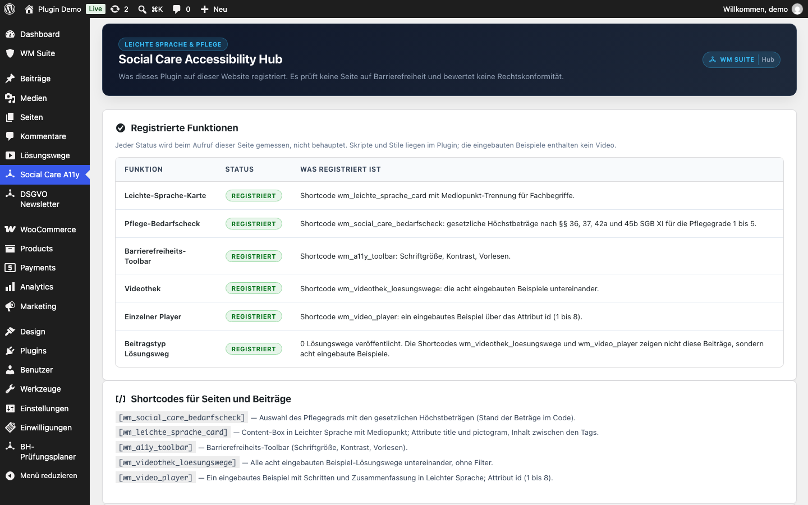
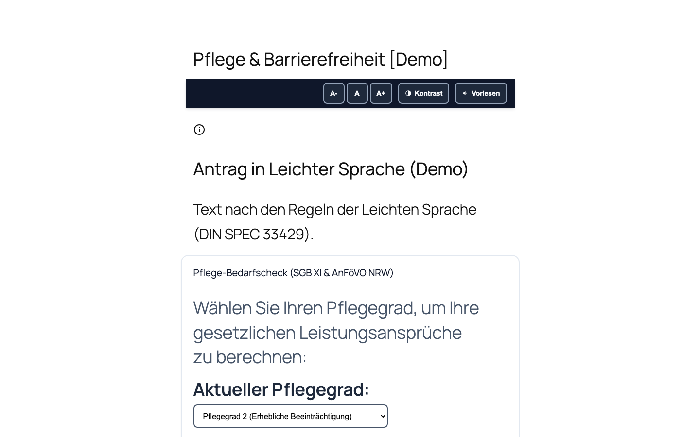

# WM Social Care Accessibility Hub (Documentación en Español)

<p align="center">
  <a href="README.md"></a>
  <a href="README.de.md"></a>
  <a href="README.es.md"></a>
</p>

> **Cinco shortcodes para sitios de cuidados y asistencia — una consulta de prestaciones con los importes legales del SGB XI, una tarjeta en Lenguaje Fácil (Leichte Sprache), una barra de accesibilidad y una videoteca con ocho guías de ejemplo integradas — más el tipo de entrada «Lösungsweg», Block Bindings y etiquetas dinámicas para GenerateBlocks; el plugin no revisa ni vuelve accesible un sitio**  
> **Página del plugin:** [https://arnoldwender.com/es/plugins-wordpress/wm-social-care-accessibility-hub/](https://arnoldwender.com/es/plugins-wordpress/wm-social-care-accessibility-hub/)  
> **Desarrollado con un agentic workflow:** creado con agentes de programación de IA. Revísalo y pruébalo como cualquier código de terceros antes de usarlo en producción.  
> **Soporte y responsabilidad:** Cero soporte (Zero Support) — errores reproducibles únicamente en [GitHub Issues](https://github.com/arnoldwender/wm-wp-social-care-accessibility-hub/issues) · sin soporte privado · TAL CUAL («AS IS») / sin responsabilidad ([SUPPORT.md](SUPPORT.md))

> Este archivo describe lo que el plugin entrega en la versión 1.3.2, medido contra el código: cinco shortcodes (`[wm_social_care_bedarfscheck]`, `[wm_leichte_sprache_card]`, `[wm_a11y_toolbar]`, `[wm_videothek_loesungswege]`, `[wm_video_player]`), el tipo de contenido `wm_loesungsweg` con cuatro taxonomías, dos rutas REST `GET` de solo lectura bajo `wm-social-care/v1` con limitación de peticiones por IP mediante HMAC-SHA256 en transitorios, WP-CLI `wp wm-social-care calc` y `seed`, una pantalla de administración con casilla opt-in de limpieza al desinstalar, hooks para desarrolladores (`wm_social_care_bedarfscheck_result`, `wm_social_care_loesungswege_items`, `wm_social_care_rate_limit_per_minute`, `wm_social_care_ready`), una fuente Block Bindings de WordPress 6.5+ (`wm-social-care/info`), una etiqueta dinámica de GenerateBlocks 2.x (`{{wm_social_care_info}}`), 28 catálogos gettext compilados y un adaptador spoke opcional para WM Suite Hub.

---

## Capturas en vivo

!Banner de WM Social Care Accessibility Hub

| Panel de administración | Shortcodes en frontend |
|---|---|
|  |  |

---

## Qué hace el plugin

1. **Consulta de prestaciones:** `[wm_social_care_bedarfscheck]` muestra un selector de grados de dependencia (Pflegegrad) 1–5 y, para el grado elegido, el Entlastungsbetrag (§ 45b SGB XI, 131 € al mes, 1.572 € al año), el Pflegegeld (§ 37: 0 / 347 / 599 / 800 / 990 €) y, desde el grado 2, el importe anual conjunto para Verhinderungs- y Kurzzeitpflege (§ 42a, 3.539 €), con vigencia `2025-07-01`. El resultado se calcula en el navegador; no se envía ni se guarda nada.
2. **Tarjeta en Lenguaje Fácil:** `[wm_leichte_sprache_card title="…" pictogram="…"]texto[/wm_leichte_sprache_card]` imprime el texto encerrado, escapado y en párrafos, con Mediopunkt (·) en 15 palabras compuestas fijas del sector de cuidados. No reescribe ni valida el texto.
3. **Barra de accesibilidad:** `[wm_a11y_toolbar]` imprime cinco botones: tamaño de letra (reducir, restablecer, ampliar al 120 % y 140 % en `<html>`), alto contraste (`aria-pressed`) y lectura en voz alta mediante síntesis de voz del navegador.
4. **Videoteca y reproductor individual:** `[wm_videothek_loesungswege]` lista los ocho ejemplos integrados en `Seed_Data_Manager`; `[wm_video_player id="1"]` muestra uno de ellos (IDs 1–8; un ID desconocido no imprime nada).
5. **Modelo de contenido:** tipo de entrada público `wm_loesungsweg` con las taxonomías `wm_kategorie`, `wm_zielgruppe`, `wm_hilfsmittel` y `wm_pflegegrad`.
6. **REST:** `GET /wp-json/wm-social-care/v1/loesungswege` devuelve los ocho ejemplos; `GET /wp-json/wm-social-care/v1/bedarfscheck?pflegegrad=1..5` devuelve los importes de un grado (por defecto 2; cualquier otro valor responde 400). Ambas son de solo lectura y están protegidas por `REST_Controller::check_public_read_permission()` con límite de 60 solicitudes/minuto por digest HMAC-SHA256 de IP.
7. **WP-CLI:** `wp wm-social-care calc --pflegegrad=<1-5>` imprime los importes en formato alemán; `wp wm-social-care seed` lista los ocho ejemplos y no escribe en la base de datos.
8. **Administración y desinstalación opt-in:** menú *Social Care A11y* (posición 30), seis filas medidas de registro, referencia de shortcodes y la opción opt-in `wm_social_care_delete_data_on_uninstall` (por defecto `'0'`). Por defecto, `uninstall.php` conserva todas las opciones y contenidos.
9. **Ecosistema y hooks:** fuente Block Bindings de WordPress 6.5+ (`wm-social-care/info`), etiqueta dinámica de GenerateBlocks 2.x (`{{wm_social_care_info}}`), acción `wm_social_care_ready` y filtros `wm_social_care_bedarfscheck_result`, `wm_social_care_loesungswege_items` y `wm_social_care_rate_limit_per_minute`.
10. **Spoke de WM Suite Hub y traducciones:** registro mediante `wm_register_suite_module` cuando `wm-suite-hub` está instalado; funciona de forma autónoma sin el hub. Incluye 28 catálogos `.po`/`.mo` compilados en `languages/` para el dominio `wm-social-care-accessibility-hub`.

### No incluido

Ninguna revisión de accesibilidad de las páginas ni evaluación de si un sitio cumple BFSG, BITV 2.0, WCAG u otro requisito; ninguna traducción automática a Lenguaje Fácil; ningún video de lengua de señas propio; ninguna visualización de entradas `wm_loesungsweg` en la videoteca; ningún almacenamiento de sesiones de visitantes, exportación ni informe de auditoría; ningún cálculo individual ni asesoramiento jurídico.

---

## Inicio rápido

1. Instala y activa el plugin (WordPress 6.4+, PHP 8.1+). No crea tablas propias.
2. Pon `[wm_social_care_bedarfscheck]` en una página sobre prestaciones y revisa antes la línea de NRW frente a tu situación.
3. Pon `[wm_leichte_sprache_card title="Information in Leichter Sprache"]…[/wm_leichte_sprache_card]` alrededor de un texto ya redactado en Lenguaje Fácil.
4. Pon `[wm_a11y_toolbar]` al inicio del contenido de la página.
5. Antes de usar `[wm_videothek_loesungswege]` o `[wm_video_player]`, abre la página: los ejemplos integrados no tienen video; muestran los pasos y un resumen en Lenguaje Fácil (Problemas conocidos).

Clases, rutas, hooks, hoja de tokens y adaptador del hub: **[README.md](README.md)** (referencia) y **[DEVELOPERS.md](DEVELOPERS.md)**.

```bash
php tests/test-suite.php
php tests/test-pot-freshness.php
php tests/test-standalone-load.php
bash tests/run-mutations.sh
```

### Problemas conocidos

- Los ocho ejemplos incluidos no tienen video: los cinco que apuntaban a un host que nunca resolvió (NXDOMAIN) muestran desde el 19.11.2026 los pasos y el texto en lectura fácil sin reproductor (decisión abierta D8).
- La consulta nombra «AnFöVO NRW» y el pie de la tarjeta en Lenguaje Fácil menciona DIN SPEC 33429 en cualquier sitio (pendiente de decisión de Arnold).
- Los importes y la frase «gilt unverändert 2026» están fijos en el código hasta el próximo cambio legal.
- La barra se restablece en cada carga de página y usa IDs de elemento fijos (una sola instancia por página).

---

## Cumplimiento

- **Qué aporta el plugin:** piezas que un proveedor de cuidados puede colocar en sus páginas. No audita el sitio, no lo vuelve accesible y no evalúa si cumple BFSG, BITV 2.0, WCAG, BGG, SGB XI o AnFöVO.
- **Peticiones salientes:** el PHP del plugin no realiza ninguna.
- **Datos personales:** no se guardan entradas de visitantes ni direcciones IP en claro; el límite de tasa REST almacena únicamente un contador temporal de 60 segundos sobre un hash HMAC-SHA256.

---

## Licencia

Distribuido bajo licencia **GNU General Public License v2 o posterior** (`GPL-2.0-or-later`).  
Copyright (C) 2026 Arnold Wender.  
