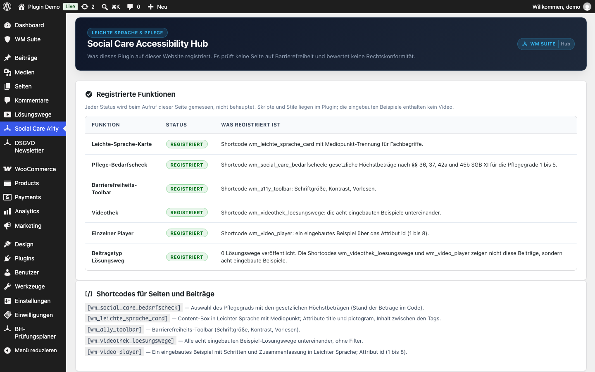
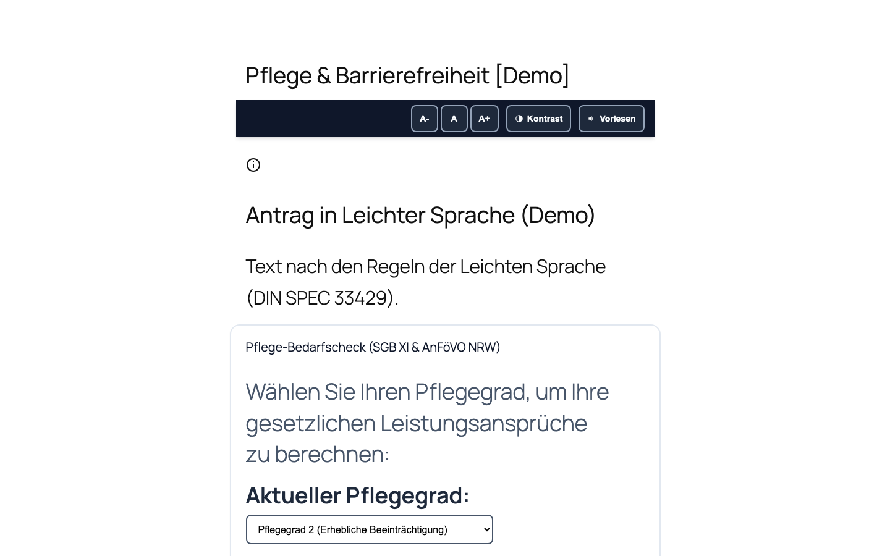

# WM Social Care Accessibility Hub

<p align="center">
  <a href="README.md"></a>
  <a href="README.de.md"></a>
  <a href="README.es.md"></a>
  <a href="#translated-documentation"></a>
</p>

<p align="center">
  <a href="https://wordpress.org"></a>
  <a href="https://php.net"></a>
  <a href="https://www.gnu.org/licenses/gpl-2.0.html"></a>
</p>

> **Five shortcodes for care and support websites — a care-benefit check with the statutory SGB XI amounts, an Easy Language (Leichte Sprache) card, an accessibility toolbar and a video library of eight built-in example guides — plus a "Lösungsweg" post type, Block Bindings and GenerateBlocks dynamic tags; it does not check or make a site accessible**  
> **Plugin page:** [https://arnoldwender.com/wordpress-plugins/wm-social-care-accessibility-hub/](https://arnoldwender.com/wordpress-plugins/wm-social-care-accessibility-hub/)  
> **Built with an agentic workflow:** developed with AI coding agents. Review and test it like any third-party code before you use it in production.  
> **Support & Liability:** Zero support — reproducible bugs on [GitHub Issues](https://github.com/arnoldwender/wm-wp-social-care-accessibility-hub/issues) only · no private support · AS IS / no liability ([SUPPORT.md](SUPPORT.md))

> This README describes what the plugin ships, measured against the code in v1.3.2: five shortcodes (`[wm_social_care_bedarfscheck]`, `[wm_leichte_sprache_card]`, `[wm_a11y_toolbar]`, `[wm_videothek_loesungswege]`, `[wm_video_player]`), the `wm_loesungsweg` post type with four taxonomies, two read-only `GET` routes under `wm-social-care/v1` protected by transient-based HMAC-SHA256 IP rate limiting, WP-CLI `wp wm-social-care calc` and `seed`, an admin overview screen with an opt-in uninstall cleanup setting, developer hooks (`wm_social_care_bedarfscheck_result`, `wm_social_care_loesungswege_items`, `wm_social_care_rate_limit_per_minute`, `wm_social_care_ready`), a WordPress 6.5+ Block Bindings source (`wm-social-care/info`), a GenerateBlocks 2.x dynamic tag (`{{wm_social_care_info}}`), 28 compiled gettext catalogs, and an optional WM Suite Hub spoke adapter.

---

## Images

!WM Social Care Accessibility Hub banner

The banner above and the live WordPress screenshots below live in `.wordpress-org/`; the old marketing mockups were archived outside the repository on 2026-11-20 (release 1.3.0).

| Admin Overview | Frontend Shortcodes |
|---|---|
|  |  |

---

## What the plugin does

1. **Care-benefit check.** `[wm_social_care_bedarfscheck]` shows a select for care degrees 1–5 and, for the chosen degree, the Entlastungsbetrag (§ 45b SGB XI, 131 € a month, 1,572 € a year), the Pflegegeld (§ 37: 0 / 347 / 599 / 800 / 990 €) and, from care degree 2, the joint annual budget for Verhinderungs- and Kurzzeitpflege (§ 42a, 3,539 €), with the line "Stand der Beträge: 2025-07-01 (gilt unverändert 2026)". The amounts come from one table in `Care_Needs_Checker`, which WP-CLI, REST and Block Bindings also use and which additionally holds the Pflegesachleistung (§ 36: 796 / 1,497 / 1,859 / 2,299 €); they were checked on 2026-09-14 against pflege.de, pflegeabc.de and dejure.org. The result is rendered in the browser; nothing is sent or stored. Each check gets its own element IDs, so several can sit on one page, and its result region announces a change of care degree but not the result filled in on page load. The card also prints "Anerkennung NRW: Voll abrechenbar über alle Pflegekassen nach AnFöVO." for every site (see Known issues).
2. **Easy Language card.** `[wm_leichte_sprache_card title="…" pictogram="…"]text[/wm_leichte_sprache_card]` prints the enclosed text escaped, in paragraphs, inside an `<article>` with the title as heading, an information icon (or the `pictogram` text), and the footer "Text nach den Regeln der Leichten Sprache (DIN SPEC 33429)." Paragraph and line-break markup that WordPress adds to the enclosed text (in classic content and in the shortcode block) is turned back into paragraphs first, so no tag shows as text. It inserts a Mediopunkt (·) into 15 compound care words from a fixed list (for example Pflege·kasse, Entlastungs·betrag). It does not rewrite or check the text.
3. **Accessibility toolbar.** `[wm_a11y_toolbar]` prints five buttons: text size down, reset and up (120 % and 140 % on `<html>`), high contrast (yellow on black on every element, state in `aria-pressed`; the pressed contrast button and the speaking read-aloud button invert those colours) and read aloud (the browser's speech synthesis reads the first 3,000 characters of `<main>`, or `<body>`, without the toolbar's own labels, in the language of the page, German when the page declares none). Nothing is stored; a reload resets it.
4. **Video library and single player.** `[wm_videothek_loesungswege]` lists, under the heading "Beispiel-Lösungswege", the eight built-in examples of `Seed_Data_Manager` (transfer from wheelchair to bed, kitchen orientation with low vision, a sign-language app, a rollator for rough ground, tactile orientation at home, tying shoes one-handed, voice-controlled smart home, tactile pill sorting). `[wm_video_player id="1"]` shows one of them (IDs 1–8; an unknown ID renders nothing). Each card has the title, a duration badge when the example has one, a native HTML5 `<video>` with a German captions track when the example has a video, the numbered steps and a summary in Easy Language. The card styles are printed once per page.
5. **Content model.** Public post type `wm_loesungsweg` (archive `/loesungswege/`, REST `/wp/v2/loesungswege`) with the taxonomies `wm_kategorie` (hierarchical), `wm_zielgruppe`, `wm_hilfsmittel` and `wm_pflegegrad` (hierarchical). No shortcode and no plugin route reads these posts.
6. **REST.** `GET /wp-json/wm-social-care/v1/loesungswege` returns the eight examples; `GET /wp-json/wm-social-care/v1/bedarfscheck?pflegegrad=1..5` returns the amounts for one care degree (default 2; any other value answers 400). Both are read-only and guarded by `REST_Controller::check_public_read_permission()`, which enforces `GET`/`HEAD`, hashes client IPs with `hash_hmac('sha256', ...)` so raw IPs are never stored, and applies a 60-requests-per-minute transient rate limit (`wm_sc_rl_*`).
7. **WP-CLI.** `wp wm-social-care calc --pflegegrad=<1-5>` prints the amounts in German number format (the joint annual budget from care degree 2, as the check does) and ends with an error for anything but a whole number from 1 to 5; `wp wm-social-care seed` lists the eight examples and writes nothing.
8. **Admin & opt-in uninstallation.** Menu *Social Care A11y* (position 30), page `wm-social-care-accessibility-hub`: whether each of the five shortcodes and the post type is registered on this site (six measured rows), how many Lösungswege are published, the shortcode reference, and an opt-in checkbox (`wm_social_care_delete_data_on_uninstall`, default `'0'`) controlling whether `uninstall.php` deletes plugin options and rate-limit transients upon deletion. By default `uninstall.php` preserves all options and site content.
9. **Ecosystem bridges & developer hooks.** Registers WordPress 6.5+ Block Bindings source `wm-social-care/info` and GenerateBlocks 2.x dynamic tag `{{wm_social_care_info}}` exposing statutory SGB XI amounts, as-of date, and example counts; fires `do_action('wm_social_care_ready', $plugin)` on `init` and provides filters `wm_social_care_bedarfscheck_result`, `wm_social_care_loesungswege_items`, and `wm_social_care_rate_limit_per_minute`.
10. **WM Suite Hub spoke.** When `wm-suite-hub` is installed, `includes/Spoke/Social_Care_Spoke_Adapter.php` registers through `wm_register_suite_module`: health `HEALTHY` with the five shortcodes and the post type registered, `DEGRADED` when some are missing or before `init`, `ERROR` when none is; telemetry with those registrations, the example count, the host of the example videos, the published post count and the as-of date of the amounts; action `self_test`; one SBOM component. Without the hub the plugin runs on its own.
11. **Front end & translations.** The visible source strings are German and go through gettext (text domain `wm-social-care-accessibility-hub`) with 28 compiled `.po`/`.mo` catalogs in `languages/` (all 24 official EU languages plus `ar`, `en_US`, `fi`, `tr_TR`). The token sheet `assets/css/wm-social-care-frontend.css` loads in the head on pages whose content uses a styled shortcode; a shortcode that renders after the head (a widget, a template part) prints the sheet inline once, in front of its markup. Text pairs measure at least 4.5:1; field borders, button boundaries and focus outlines at least 3:1.

### Not shipped

No check of a site's pages for accessibility and no assessment of whether a site meets BFSG, BITV 2.0, WCAG or any other requirement; no automatic rewriting into Easy Language (only the Mediopunkt on 15 fixed words); no sign-language videos of its own; no display of `wm_loesungsweg` posts and no filters in the video library; no visitor session storage, export or audit report; no individual benefit calculation or legal advice (the check shows statutory maximum amounts).

---

## Quick start

1. Install and activate the plugin (WordPress 6.4+, PHP 8.1+). Activation creates no custom tables and writes no options until you save the optional uninstall setting.
2. Put `[wm_social_care_bedarfscheck]` on a page about care benefits and check the NRW line against your situation first (Known issues).
3. Put `[wm_leichte_sprache_card title="Information in Leichter Sprache"]…[/wm_leichte_sprache_card]` around a text that is already written in Easy Language.
4. Put `[wm_a11y_toolbar]` at the top of the page content where visitors should find it.
5. Before using `[wm_videothek_loesungswege]` or `[wm_video_player]`, open the page: the built-in examples carry no video; they show their steps and an Easy Language summary (Known issues).

---

## Developers

Classes, routes, hooks, Block Bindings, the token sheet and the hub adapter: **[DEVELOPERS.md](DEVELOPERS.md)**.

```bash
php tests/test-suite.php             # amounts, card, check, toolbar, library, tokens, hooks, bindings, uninstall, CLI, guards, catalogs, docs
php tests/test-pot-freshness.php     # every gettext string in code is present in languages/wm-social-care-accessibility-hub.pot
php tests/test-standalone-load.php   # the plugin loads without wm-suite-hub (own process)
bash tests/run-mutations.sh          # each correction undone once; the suite must fail every time
wp eval-file wp-content/plugins/wm-social-care-accessibility-hub/tests/wp-runtime-social-care.php --user=1   # inside WordPress
```

### Known issues

- The eight built-in examples carry no video: the five that pointed at a host that never resolved (NXDOMAIN, measured 2026-09-14) show their steps and Easy Language text without a player since 19.11.2026. Where example videos would be hosted is an open decision (fleet audit D8). The two examples of type "bild" carry no image and show text only; durations are shown for them too. Health stays `HEALTHY` while the videos do not load: it measures registrations only.
- The care-benefit check names "AnFöVO NRW" in its heading and prints that services are billable in NRW, and REST returns `has_anfoevo_subsidy: true`, on every site; the plugin cannot know whether a provider is recognised. The Easy Language card states that the text follows the rules of DIN SPEC 33429 whatever it contains, and every example card heads its summary "In Leichter Sprache (DIN SPEC 33429)". The eight examples give care and medication instructions without a source, author or review date. All of this waits for Arnold.
- The amounts and the sentence "gilt unverändert 2026" are fixed in the code; the next statutory change needs a code update.
- The toolbar resets on every page load; text size only affects text sized in `rem` or `em`; high contrast sets colours with `!important` and a CSS filter on `<html>`, which can break fixed or sticky theme elements; the accessible names of "A-", "A" and "A+" do not contain their visible text (WCAG 2.5.3); its element IDs are fixed, so a second toolbar on one page does not work.
- The check and the library print their own `<style>` per instance; the Easy Language card has no styles of its own. Headings use fixed levels (h2 for the library, h3 for the check, the card and each example), which can skip a level in some page outlines.
- `Contrast_Governor`, `Language_Level_Enum`, `Leichte_Sprache_Governor::audit_sentence_length()` / `validate_inclusion_europe_license()` and `Video_Repository::sanitize_formula_injection()` have no caller in the plugin; only the tests use them.
- The hub adapter is found only when the hub lives in `wp-content/plugins/wm-suite-hub/`.

---

## Translated documentation

Translated READMEs live in `docs/translations/README.<lang>.md`; their headings are translated and their bodies are generated from this file, which is the reference.

| Language (Native) | Locale Code | Language (Native) | Locale Code |
|---|---|---|---|
| [Български](docs/translations/README.bg.md) | `bg_BG` | [Magyar](docs/translations/README.hu.md) | `hu_HU` |
| [Čeština](docs/translations/README.cs.md) | `cs_CZ` | [Italiano](docs/translations/README.it.md) | `it_IT` |
| [Dansk](docs/translations/README.da.md) | `da_DK` | [Lietuvių](docs/translations/README.lt.md) | `lt_LT` |
| [Deutsch](README.de.md) | `de_DE` | [Latviešu](docs/translations/README.lv.md) | `lv_LV` |
| [Ελληνικά](docs/translations/README.el.md) | `el_GR` | [Malti](docs/translations/README.mt.md) | `mt_MT` |
| [English](README.md) | `en_GB` | [Nederlands](docs/translations/README.nl.md) | `nl_NL` |
| [Español](README.es.md) | `es_ES` | [Polski](docs/translations/README.pl.md) | `pl_PL` |
| [Eesti](docs/translations/README.et.md) | `et_EE` | [Português](docs/translations/README.pt.md) | `pt_PT` |
| [Suomi](docs/translations/README.fi.md) | `fi_FI` | [Română](docs/translations/README.ro.md) | `ro_RO` |
| [Français](docs/translations/README.fr.md) | `fr_FR` | [Slovenčina](docs/translations/README.sk.md) | `sk_SK` |
| [Gaeilge](docs/translations/README.ga.md) | `ga_IE` | [Slovenščina](docs/translations/README.sl.md) | `sl_SI` |
| [Hrvatski](docs/translations/README.hr.md) | `hr_HR` | [Svenska](docs/translations/README.sv.md) | `sv_SE` |

---

## Compliance

- **What the plugin provides:** building blocks a care provider can place on pages. It does not audit the site, does not make it accessible and does not assess whether the site, its texts or its benefit information satisfy BFSG, BITV 2.0, WCAG, BGG, SGB XI or AnFöVO. The benefit amounts are statutory maximum amounts, not an individual assessment.
- **Outbound requests:** the plugin's PHP makes none. The built-in examples load no external media; the read-aloud uses the browser's own speech synthesis.
- **Personal data:** no visitor form input or raw IP address is stored. The check's selection and toolbar settings stay in the browser view; REST rate limiting stores only a 60-second HMAC-SHA256 digest counter.

---

## Contribution & Security

- [CONTRIBUTING.md](CONTRIBUTING.md) · [SECURITY.md](SECURITY.md) · [CHANGELOG.md](CHANGELOG.md)

---

## License

Distributed under the **GNU General Public License v2 or later** (`GPL-2.0-or-later`).  
Copyright (C) 2026 Arnold Wender.  
